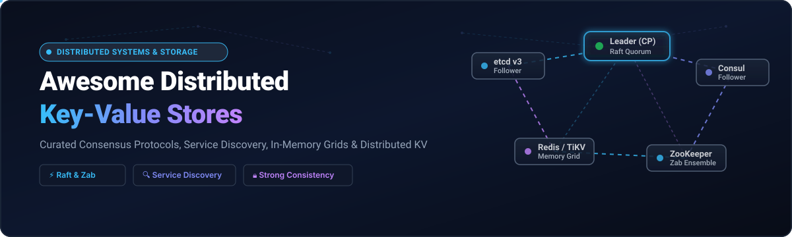

# Awesome Distributed Key-Value Stores 🌐⚡

  

  
  
  
  
  
  
  

---

## 📖 Curated Directory of Distributed Storage, Consensus & Coordination Systems

> **A comprehensive, production-grade guide to Distributed Key-Value Stores, In-Memory Data Grids (IMDGs), Consensus Engines (Raft, Paxos, Zab), Service Discovery Registries, and Cloud-Native Distributed State Infrastructure.**

Whether building cloud-native microservices on Kubernetes, configuring low-latency vector/caching layers for LLM inference workloads, or designing Byzantine-fault-tolerant metadata coordination engines, choosing the right distributed datastore architecture is a mission-critical decision.

### 🌟 Key Highlights & Architectural Taxonomy
- **Consensus & Coordination Stores (CP Guarantee)**: Linearizable consistency, atomic compare-and-swap, reliable streaming watches, and distributed lease/lock primitives ([`etcd`](https://github.com/etcd-io/etcd), [`Apache ZooKeeper`](https://github.com/apache/zookeeper), [`Canonical Dqlite`](https://github.com/canonical/dqlite)).
- **High-Throughput In-Memory Data Stores & Caching**: Sub-millisecond reads/writes, cluster sharding, and rich data structures ([`Redis`](https://github.com/redis/redis), [`Dragonfly`](https://github.com/dragonflydb/dragonfly), [`Valkey`](https://github.com/valkey-io/valkey)).
- **Globally Scalable Distributed ACID Key-Value**: Multi-region horizontal scalability, transaction engines, and hybrid transactional/analytical capabilities ([`TiKV`](https://github.com/tikv/tikv), [`Apple FoundationDB`](https://github.com/apple/foundationdb)).
- **Service Discovery & Service Mesh Networking**: Dynamic DNS registration, multi-datacenter health checking, and mesh intentions ([`HashiCorp Consul`](https://github.com/hashicorp/consul), [`CoreDNS`](https://github.com/coredns/coredns), [`Eureka`](https://github.com/Netflix/eureka), [`Kuma`](https://github.com/kumahq/kuma)).
- **Embedded LSM & Key-Value Engines**: Ultra-fast pure Go storage engines for SSD/NVMe persistence ([`BadgerDB`](https://github.com/dgraph-io/badger)).

---

## 📑 Table of Contents

- [📊 Sector Overview & Market Dynamics](#-sector-overview--market-dynamics)
- [☁️ SaaS/Hosted Platforms](#️-saashosted-platforms)
- [🚀 Open-Source GitHub Projects](#-open-source-github-projects)
  - [🏆 Categorized Comparison Matrix](#-categorized-comparison-matrix)
  - [🔍 Detailed Project Breakdowns](#-detailed-project-breakdowns)
- [🤝 How to Contribute](#-how-to-contribute)
- [☕ Support & Sponsorship](#-support--sponsorship)
- [⚖️ Disclaimer & Architectural Trade-offs](#️-disclaimer--architectural-trade-offs)
- [📈 Star History](#-star-history)

---

## 📊 Sector Overview & Market Dynamics

The global distributed key-value store and in-memory database market is estimated at **$2.8B to $8.1B**, expanding at a compound annual growth rate (CAGR) of **11%–16%** through 2032. This rapid growth is fueled by low-latency caching demands, cloud microservices coordination, and real-time AI/LLM context retrieval.

The sector is **highly fragmented** across hyperscale cloud providers (AWS DynamoDB/ElastiCache, Azure Cosmos DB, GCP), specialized commercial open-core platforms (Redis, HashiCorp), and independent in-memory data fabrics. Instead of a single winner-take-all monopoly, the landscape is partitioned into specialized operational niches—ranging from strict CP consensus engines to high-throughput AP memory caches and horizontally sharded NVMe-backed transactional engines.

---

## ☁️ SaaS/Hosted Platforms

| Platform | Company Size (Valuation / Revenue) | Pricing | Free Tier / Trial Limits | Description & Key Use Cases |
| :--- | :--- | :--- | :--- | :--- |
| **HashiCorp Consul Enterprise** (HCP Consul) | **$6.4B** (Acquired by IBM) / ~$583M ARR | Self-service starting at **$0.069/hour** (base cluster) + **$0.027/hour** per service instance; custom quotes for enterprise governance tiers | **180-day free trial** with **$500 HCP credits** (up to 3 resources / 1 dedicated cluster; dev clusters auto-deleted if credits exhaust without payment method) | Commercial service networking and discovery platform featuring multi-tenancy, FIPS 140-3 compliance, global RPC rate limiting, and service mesh governance. |
| **Redis Enterprise** (Redis Cloud) | **$2.0B** valuation / ~$300M ARR | Fixed self-service plans start at **$5.00/month** (250MB storage); flexible pay-as-you-go starting at **$0.881/GB-hour**; high-availability enterprise clusters ~$1,500–$3,500/month | **Free forever plan** with **30MB storage**, 30 concurrent connections, and 1 database on shared infrastructure (no credit card required) | Enterprise in-memory data platform featuring active-active geo-distribution (CRDTs), 99.999% uptime SLA, Redis on Flash storage tiering, and high-speed distributed caching/locking. |
| **Hazelcast Enterprise** (Hazelcast Viridian) | **~$100M–$250M** valuation / ~$25M–$32M ARR | Median commercial contract starts around **$12,700–$23,338/year** (~$1,058/month); self-managed licenses billed annually per JVM node | **14-day free trial** of Viridian Cloud Standard capped at **0.5 GiB storage**, single-member cluster, auto-pause after 24h of inactivity (OSS platform is also free for self-hosting) | In-memory stream computing and data grid with CP Subsystem (Raft consensus), WAN replication, and enterprise security for high-throughput distributed state management. |

---

## 🚀 Open-Source GitHub Projects

All open-source repositories below are sorted in **descending order by GitHub star count**. Each project includes a real-time social star badge linked directly to that repository's stargazers page.

### 🏆 Categorized Comparison Matrix

| Project | GitHub Stars | Primary Consensus / Protocol | Primary Architecture Focus | License |
| :--- | :--- | :--- | :--- | :--- |
| **Redis** |  | Asynchronous / Sentinel / Raft-Redlock | In-Memory Data Structure Store & Caching | BSD-3-Clause / RSALv2 / SSPLv1 |
| **etcd** |  | Raft Consensus (CP) | Distributed Configuration & Kubernetes Metadata | Apache-2.0 |
| **Dragonfly** |  | Multi-threaded Shared-Nothing | Next-Gen Multi-Threaded In-Memory Datastore | BSL 1.1 |
| **HashiCorp Consul** |  | Raft + Serf (Gossip Protocol) | Service Discovery, Mesh Networking & KV Store | BSL 1.1 |
| **Valkey** |  | Asynchronous Cluster Gossip | High-Performance In-Memory Data Store (Linux Foundation) | BSD-3-Clause |
| **TiKV** |  | Multi-Raft Consensus (CP) | Distributed Transactional Key-Value Database | Apache-2.0 |
| **Apple FoundationDB** |  | Multi-Paxos Distributed ACID | Distributed, Multi-Model ACID Transactional Store | Apache-2.0 |
| **BadgerDB** |  | WiscKey LSM Storage Engine | Embeddable Persistent Key-Value Store in Go | Apache-2.0 |
| **CoreDNS** |  | DNS Plugin Chain Architecture | Kubernetes Standard DNS & Service Discovery | Apache-2.0 |
| **Apache ZooKeeper** |  | Zab Protocol (Paxos Variant, CP) | Enterprise Distributed Coordination & Configuration | Apache-2.0 |
| **Netflix Eureka** |  | AP Peer-to-Peer Replication | Service Registration & Discovery (Spring Cloud) | Apache-2.0 |
| **Hazelcast Platform** |  | Raft CP Subsystem + AP Partitioning | In-Memory Data Grid & Real-Time Stream Computing | Apache-2.0 |
| **Canonical Dqlite** |  | C-Raft Consensus | Distributed SQLite with Automatic Failover | LGPL-3.0 |
| **Kuma** |  | Envoy Control Plane CP/AP | Universal Service Mesh & Discovery Control Plane | Apache-2.0 |
| **Apache Curator** |  | Client-side Coordination Recipes | Java Client & Patterns for ZooKeeper | Apache-2.0 |

---

### 🔍 Detailed Project Breakdowns

#### 1. [Redis](https://github.com/redis/redis) 
- **Overview**: The world's ubiquitous in-memory data structure store used as a distributed cache, message broker, streaming engine, and lightweight coordination layer.
- **Key Features**: Supports strings, hashes, lists, sets, sorted sets with range queries, bitmaps, hyperloglogs, geospatial indexes, and streams.
- **Trade-offs**: Asynchronous master-replica replication means cluster failover can lose acknowledged writes; best for high-throughput caching and lightweight locks rather than strict CP transactional metadata.

#### 2. [etcd](https://github.com/etcd-io/etcd) 
- **Overview**: Strongly consistent, distributed key-value store that provides a reliable way to store critical metadata across a distributed cluster; the backbone of Kubernetes.
- **Key Features**: Implements Raft consensus with linearizable reads, multi-version concurrency control (MVCC), atomic transactions, leases, and reliable event streams/watches.
- **Trade-offs**: Tuned specifically for metadata up to a few gigabytes; not architected for high-volume unstructured binary or bulk analytical storage.

#### 3. [Dragonfly](https://github.com/dragonflydb/dragonfly) 
- **Overview**: Highly scalable in-memory datastore designed as a drop-in replacement for Redis and Memcached, re-architected from the ground up with a multi-threaded, shared-nothing architecture on modern hardware.
- **Key Features**: Delivers 25x the throughput of standard Redis, scales vertically on multi-core instances, incorporates proactive cache eviction algorithms, and requires zero code modifications for Redis clients.
- **Trade-offs**: Focused on memory caching and operational speed; does not provide distributed Raft/CP coordination primitives out of the box.

#### 4. [HashiCorp Consul](https://github.com/hashicorp/consul) 
- **Overview**: Cloud networking and service discovery platform featuring health checking, multi-datacenter routing, service mesh intentions, and hierarchical KV configuration.
- **Key Features**: DNS and HTTP API interfaces, distributed health probes, dynamic routing, and multi-region WAN gossip federation via Serf.
- **Trade-offs**: KV store is designed for configuration and feature flag thresholds; does not scale horizontally to millions of rapidly mutating coordination keys compared to dedicated stores like etcd.

#### 5. [Valkey](https://github.com/valkey-io/valkey) 
- **Overview**: High-performance open-source in-memory data store forked from Redis under the Linux Foundation to preserve community-driven, truly open-source (BSD-3-Clause) stewardship.
- **Key Features**: Drop-in protocol compatibility with Redis 7.2.4 APIs, multi-threaded command execution enhancements, active Linux Foundation governance, and broad cloud vendor ecosystem backing.
- **Trade-offs**: Inherits standard asynchronous master-replica failover mechanics; locks are best-effort without specialized Raft CP plugins.

#### 6. [TiKV](https://github.com/tikv/tikv) 
- **Overview**: A CNCF-graduated, distributed, transactional key-value database written in Rust. Acts as the scalable distributed storage engine beneath TiDB.
- **Key Features**: Multi-Raft group architecture for dynamic range-sharding, distributed ACID transactions powered by Google Percolator model, automatic rebalancing, and petabyte-scale horizontal elasticity.
- **Trade-offs**: Substantially higher operational and architectural complexity than single-binary configuration registries; requires Placement Driver (PD) components.

#### 7. [Apple FoundationDB](https://github.com/apple/foundationdb) 
- **Overview**: Distributed, un-opinionated transactional storage engine developed by Apple that delivers strict ACID guarantees across large multi-node clusters.
- **Key Features**: Decoupled transaction management, multi-model layers (SQL, document, graph built on top of ordered key-value), deterministic simulation testing framework, and battle-tested Apple CloudKit production heritage.
- **Trade-offs**: Client bindings involve native C bindings; operations and cluster recovery topologies require deep systems understanding.

#### 8. [BadgerDB](https://github.com/dgraph-io/badger) 
- **Overview**: Embeddable, persistent, pure-Go key-value datastore based on the WiscKey paper, separating keys from values to drastically reduce SSD write amplification.
- **Key Features**: Optimized specifically for NVMe SSD random-read bandwidth, ACID transaction support, pure Go with zero CGO dependencies, and high-performance ingestion.
- **Trade-offs**: Single-node embedded engine out of the box; requires custom distributed network framing (such as Raft) to coordinate across multiple servers.

#### 9. [CoreDNS](https://github.com/coredns/coredns) 
- **Overview**: Fast, flexible DNS server written in Go that chains plugins to serve DNS queries and acts as the default service discovery engine across Kubernetes clusters.
- **Key Features**: Dynamic etcd and Kubernetes backend integration, metrics exposure via Prometheus, gRPC integration, and customizable request handling chains.
- **Trade-offs**: Specialized for DNS protocol resolutions and discovery records; not an arbitrary key-value metadata store.

#### 10. [Apache ZooKeeper](https://github.com/apache/zookeeper) 
- **Overview**: The battle-tested foundational coordination service for distributed systems, providing hierarchical znodes, ephemeral nodes, and event notifications.
- **Key Features**: Zab consensus protocol (Paxos derivative), battle-tested leader election, distributed locking primitives, and deep enterprise Hadoop/HBase/Kafka integration.
- **Trade-offs**: Legacy Jute RPC protocol; does not offer linearizable reads by default without sync calls; recipes and connection re-try logic require client libraries like Apache Curator.

#### 11. [Netflix Eureka](https://github.com/Netflix/eureka) 
- **Overview**: Highly available, AP-focused service registration and discovery engine originally developed by Netflix for AWS multi-zone deployments and the Spring Cloud ecosystem.
- **Key Features**: Client-side load balancing, self-preservation mode during network partitions, and simple REST API integration.
- **Trade-offs**: Favors availability over consistency (eventual consistency); unmaintained for newer microservice architectures compared to Consul or Kubernetes DNS.

#### 12. [Hazelcast Platform](https://github.com/hazelcast/hazelcast) 
- **Overview**: Real-time stream processing and distributed in-memory computing platform combining high-throughput data grid collections with a Raft-based CP Subsystem.
- **Key Features**: In-memory maps, queues, distributed locks, near-cache acceleration, SQL querying over memory records, and WAN cross-cluster replication.
- **Trade-offs**: Enterprise security, WAN replication, and advanced persistence require commercial licenses.

#### 13. [Canonical Dqlite](https://github.com/canonical/dqlite) 
- **Overview**: Pure C, lightweight distributed SQLite engine with embedded Raft consensus, powering Canonical MicroK8s and LXD cluster state.
- **Key Features**: Embedded low-memory footprint, Raft consensus algorithm built in C, transactional SQL semantics, and seamless integration for edge IoT and lightweight Kubernetes clusters.
- **Trade-offs**: Focused on transactional relational SQLite workloads rather than high-concurrency arbitrary key-value dictionary caching.

#### 14. [Kuma](https://github.com/kumahq/kuma) 
- **Overview**: Universal open-source service mesh control plane built on Envoy, delivering automated service discovery, zero-trust mTLS encryption, and cross-zone routing.
- **Key Features**: Seamless multi-zone and multi-cluster mesh coordination, Kubernetes and bare-metal support, and declarative traffic policies.
- **Trade-offs**: Complete service mesh control plane; introduces sidecar proxy overhead if only simple key-value coordination is required.

#### 15. [Apache Curator](https://github.com/apache/curator) 
- **Overview**: Comprehensive Java/JVM client wrapper and coordination recipe collection for Apache ZooKeeper.
- **Key Features**: Production-grade implementations of leader election, distributed reentrant locks, barriers, counters, and caching listeners.
- **Trade-offs**: Java-only client framework; depends strictly on underlying ZooKeeper server ensembles.

---

## 🤝 How to Contribute

Contributions, project suggestions, and documentation enhancements are warmly welcomed! 💡

1. **Fork the Repository** to your personal GitHub account.
2. **Add or Update Entries** in `README.md` following the tabular and detailed breakdown formatting guidelines.
3. **Include Key Criteria**: Official project link, licensing, architecture focus, star badge with `style=social&color=white`, and technical consensus mechanics.
4. **Submit a Pull Request** with a concise description explaining why the tool is beneficial to distributed systems engineers.

---

## ☕ Support & Sponsorship

If you find this curated directory useful for your research, team, or production architectures, consider showing your support:

- ⭐ **Star this repository** to help others discover it across GitHub.
- 🍴 **Fork and share** with colleagues, devops teams, and platform engineering channels.
- ☕ **Buy a coffee & sponsor ongoing maintenance** via the official [GitHub Sponsor Dashboard](https://github.com/sponsors/ishandutta2007).

Thank you for supporting open-source tools and distributed systems engineering! 🙌

---

## ⚖️ Disclaimer & Architectural Trade-offs

- **Community Curated**: This repository is a curated collection for educational, architectural, and evaluation purposes; it does not constitute an explicit commercial endorsement.
- **Coordination Store vs. Service Discovery vs. In-Memory Cache**:
  - **etcd, ZooKeeper, and FoundationDB** are **coordination stores (CP)** engineered for linearizable reads, ACID transactions, and reliable cluster-wide leases/locks.
  - **Consul, CoreDNS, and Eureka** prioritize **service registration & discovery**, focusing on service health checks, dynamic network DNS, and mesh federation.
  - **Redis, Dragonfly, and Valkey** are built for **sub-millisecond data caching & streaming**, providing extreme throughput with eventual or best-effort consistency primitives.
- **Production Best Practices**: Always configure mutual TLS (mTLS), automated snapshot backups, isolated consensus networks, and quorum monitoring before deploying distributed KV systems in production environments.

---

## 📈 Star History

---

  <b>Crafted with ❤️ for platform engineers, SREs, and distributed systems architects.</b>

